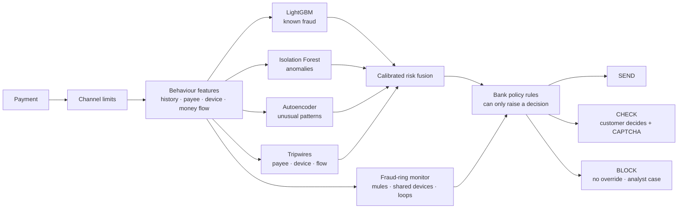
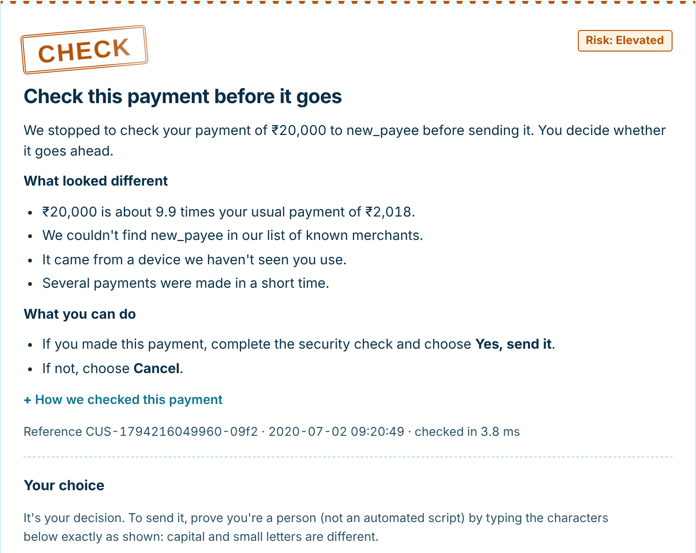
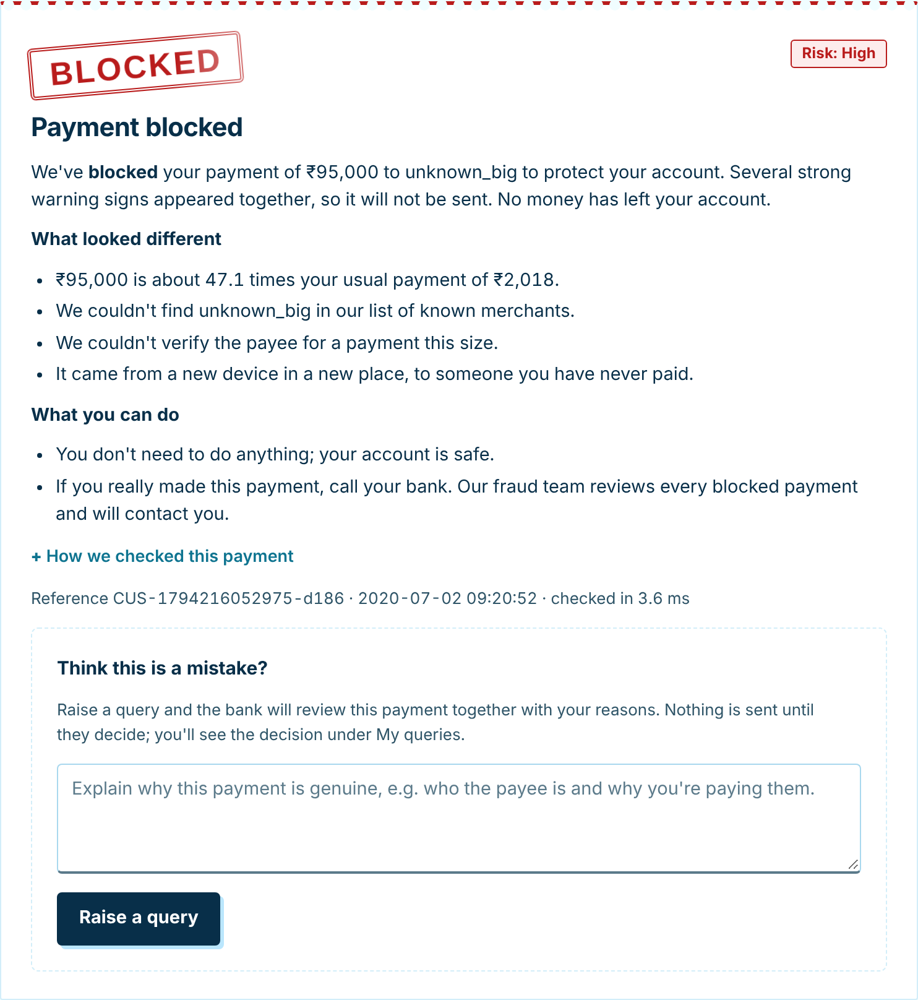
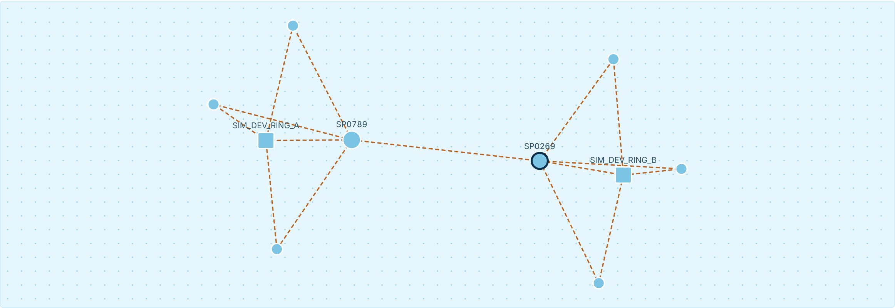
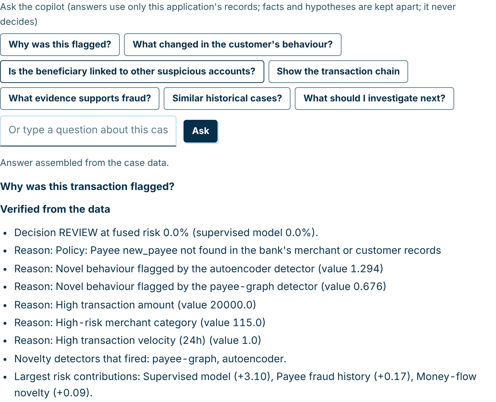
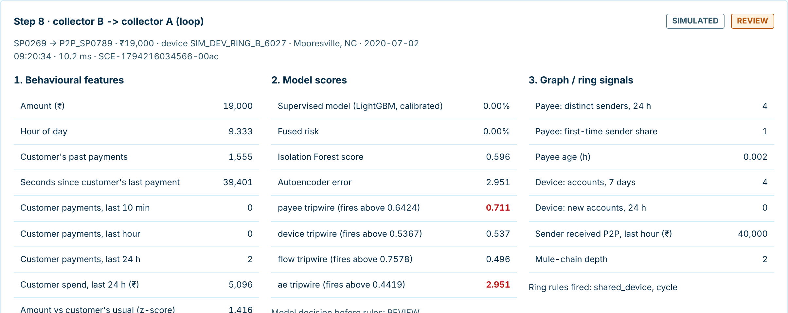

<p align="center">
  
</p>

<p align="center">
  <b>Datanova 2026 Global Data-thon</b> · Problem <b>DN-FN-01</b> (Finance, Advanced)<br>
  Team: <b>Chakilam Anvith Sree</b> · <b>Nooka Sai Krishna</b>
</p>

<p align="center">
  <a href="submission/payTrace_Submission.pptx">Pitch deck</a> ·
  <a href="submission/payTrace_Project_Report.pdf">Project report</a> ·
  <a href="reports/PAYTRACE_2_FINAL_EVALUATION.md">Full evaluation</a> ·
  <a href="REAL_DATA.md">Real-data results</a> ·
  <a href="ARCHITECTURE.md">Architecture</a> ·
  Demo video: <i>link to be added</i>
</p>

---

Once a payment completes, the money is usually gone. **payTrace checks every payment before it completes** and decides
in milliseconds whether to **send** it, **check** it with the customer, or **block** it. Every decision comes with
reasons a customer can understand and evidence an analyst can act on.

It is a working banking application, not a notebook. Customers send money, analysts investigate cases, and admins
monitor the models. Other systems can call the same engine through a REST API.

## Results at a glance

| | Result | Data |
|---|---|---|
| **Fraud caught** | **98.8%** of fraud on the unseen last 6 months, at a 1.7% false-alarm rate (PR-AUC 0.94) | Sparkov card payments, 1.85M rows (the app's model) |
| **Real payments** | PR-AUC **0.461 → 0.494** without fraud labels, **0.669** with fraud labels at least 7 days old | IEEE-CIS, real anonymised Vesta payments, unseen last 25% |
| **Money saved** | Estimated fraud loss **₹5.88 Cr → ₹0.98 Cr** on the real-data test period (₹2.02 Cr with the 2.0 model) | IEEE-CIS, 128,823 test payments, 4,393 fraud |
| **Never-seen fraud** | Recall on a fraud pattern removed from training **69% → 76%**; QR-swap fraud flagged from its **first payment** instead of after 87.6 hours | Synthetic UPI-style data (our generator) |
| **Speed** | Full decision **7.5 ms p50 / 14.2 ms p99**, including rules, ring checks, explanation and database writes | Sparkov app model, 2 vCPU |

Every number is produced by a script in this repository and measured on a time period that was never used for training
or tuning. [How each result was measured](#how-results-are-measured).

## How it works



1. **Hybrid detection.** A supervised model catches known fraud. Three unsupervised detectors catch fraud nobody
   labelled yet. Isotonic calibration and a logistic fusion turn them into one risk score with visible weights.
2. **Fraud-ring intelligence.** Every payment is checked against a live network of customers, devices and payees.
   It looks for collector accounts, shared devices, bursts of new accounts, mule chains and money moving in a loop.
   Offline analysis groups suspicious entities into rings with Louvain communities, PageRank and betweenness.
3. **Bank policy layer.** Deterministic rules (channel limits, unverified payees, amounts far above normal) sit
   around the models, as in a real payment system. Rules can only make a decision stricter, never weaker.
4. **Trust that is earned.** A payee becomes verified after the customer confirms a payment on that device. Later
   payments up to the confirmed amount go straight through, unless a ring or confirmed-fraud signal appears.
5. **Explanations, not scores.** Customers see what looked different in real numbers, for example
   "₹20,000 is about 9.9 times your usual payment of ₹2,018". Analysts see SHAP reasons, the risk breakdown and the
   payment network.

## The application

<table>
  <tr>
    <td width="50%"></td>
    <td width="50%"></td>
  </tr>
  <tr>
    <td><b>Check.</b> A moderate-risk payment is paused. The customer sees why and decides: send it after a CAPTCHA, or cancel.</td>
    <td><b>Block.</b> A high-risk payment is stopped with no override, because scammers often talk victims into approving. The customer can raise a query, which an admin reviews.</td>
  </tr>
</table>



**Investigation graph.** Click any customer, device or payee to see its evidence and expand the network around it.
Solid red links are fraud an analyst confirmed. Dashed amber links are only flagged by the model.

<table>
  <tr>
    <td width="50%"></td>
    <td width="50%"></td>
  </tr>
  <tr>
    <td><b>Analyst copilot.</b> Answers questions such as "why was this flagged?" or "is the payee connected?" from stored records. It keeps verified facts apart from hypotheses. An LLM may reword the facts but never decides.</td>
    <td><b>Scenario lab.</b> Ten simulated attacks (account takeover, card testing, UPI mules, QR fraud, a coordinated ring and more) run through the live engine. Each step shows features, scores, ring signals, rules and the decision. Outcomes are never scripted.</td>
  </tr>
</table>

| Role | What they can do |
|---|---|
| **Customer** | Send money, confirm or cancel checked payments, raise a query on a blocked payment and follow it under *My queries*. |
| **Fraud analyst** | Work the case queue with SHAP reasons, a 48-hour evidence timeline, the ring panel, graph explorer and copilot. Confirm fraud or release the payment. |
| **Admin** | Live KPIs, simulated traffic, the scenario lab, model evidence, drift and feedback monitoring, query review, users and the audit log. |
| **Other systems** | `POST /api/v1/score` with a bearer token returns the decision, risk and reasons. |

## Quick start

Requires Python 3.10 or newer. On macOS, LightGBM also needs `brew install libomp`.

```bash
git clone https://github.com/Anvi2310/payTrace.git
cd payTrace
python3 -m venv .venv && source .venv/bin/activate
pip install -r requirements.txt
bash run_app.sh
```

Open **http://localhost:8000** and sign in as **`demo` / `demo1234`** (admin). The login page lists the customer and
analyst demo accounts, which use the same password.

The first run generates the synthetic dataset and trains its models, which takes a few minutes. To run the app on the
Sparkov model used for the results above, download the Kaggle data and train it as described in
[REAL_DATA.md](REAL_DATA.md). Raw datasets and trained models are not stored in this repository because of their size.

**Optional AI explanations.** Without a key, explanations come from templates. To have an LLM write the customer messages
and analyst summaries, add a free key to `.env` (`GEMINI_API_KEY=...` or `GROQ_API_KEY=...`) and restart. The models
always make the decision; the LLM only rewords verified evidence, and the app falls back to templates if it is slow.

<details>
<summary><b>More commands</b></summary>

| Task | Command |
|---|---|
| Run the tests | `python -m pytest -q` |
| Train on the synthetic data | `python -m src.train_v2 --dataset v2` |
| Prepare the Kaggle data | `python -m src.adapters sparkov ...` and `python -m src.adapters ieee ...` (see `src/adapters.py`) |
| Real-data experiments | `python -m src.experiments_real`, then `--finish`, then `python -m src.report_real` |
| IEEE-CIS model study | `python -m src.v21.ieee_opt build`, then `run <name>` and `final` (see the file header) |
| Final evaluation report | `python -m src.v21.report` |
| Synthetic experiments (~25 min) | `python -m src.experiments`, then `python -m src.report_experiments` |
| Latency benchmark | `python -m src.benchmark_v2` |
| Streaming with fault injection | `python -m src.stream_v2 --rate 300 --dup-rate 0.02 --jitter 20` |
| Retrain from analyst labels | `python -m src.retrain [--promote]` |
| Analytics dashboard (Streamlit) | `./run_v2.sh`, then http://localhost:8501 |
| Docker | `docker compose up` |

</details>

## How results are measured

* **Time-based splits.** Each dataset is split in time: train 0–50%, early stopping 50–60%, calibration 60–67%,
  thresholds 67–75%, **test 75–100%**. Nothing from the test period is used for training or tuning.
* **Past-only features.** Behaviour features use only payments before the one being scored. Fraud labels are used only
  after a realistic delay (7 or 30 days), as with chargebacks.
* **Unseen fraud.** Leave-one-pattern-out: one fraud pattern is removed from training at a time, then measured on the
  test period. Detection delay and recall at a fixed false-positive rate are reported.
* **Business cost.** Loss is the value of missed fraud plus ₹100 per false alarm. Thresholds are chosen to minimise it.
* **Honest reporting.** Results that did not improve are reported too. For example, ring signals add about 0.1 points of
  false positives on fraud patterns the model already knows, and no GNN was built because there was no measured gain.

| Dataset | What it is | Size | Used for |
|---|---|---|---|
| **Sparkov** (Kaggle, CC0) | Simulated US card payments | 1.85M payments, 999 customers | The app's model |
| **IEEE-CIS** (Kaggle, Vesta) | Real, anonymised card-not-present payments | 590,540 payments | Real-data evaluation and replay |
| **Synthetic UPI** | Our own generator with 7 fraud patterns | — | Unseen-fraud and fraud-ring experiments |

## Responsible AI and security

* **Humans decide the hard cases.** Checked payments go to the customer and blocked payments go to analysts. Labels that
  contradict an earlier label need a note and a second analyst.
* **The LLM cannot decide.** It only rewords evidence that the models and records have already produced.
* **Explainable by default.** Every alert shows SHAP reasons, fusion contributions, tripwires and policy rules.
* **Secrets stay local.** Keys live only in a git-ignored `.env`, and API keys are sent in headers, never in URLs.
* **Access control and audit.** Customer, analyst and admin roles with hashed passwords, rate limits on feedback, and
  an audit log of every action.
* **Fairness.** False-positive rates are reported by city, channel and account age.
* **Monitoring.** PSI and Page-Hinkley drift alarms. A challenger model is promoted only if it beats the champion.

## Limitations

* Sparkov is simulated, and IEEE-CIS is real but anonymised and has no merchant or customer id. Neither is a bank's own
  data, so results on live traffic will differ.
* The app's model has no device or person-to-person training data. Device and mule signals in the app come from the
  ring monitor and policy rules.
* The CAPTCHA proves a person is answering, not who they are. A real deployment would add a one-time code sent to the
  registered phone.
* Customer device and location are chosen in demo controls; a mobile app would read them from the phone.
* The tested path is SQLite with an in-process event bus. Kafka and PostgreSQL adapters exist but were not run here.
* Nothing has been validated on live banking infrastructure.

## Repository layout

```
webapp/      server.py (routes, auth)  engine.py (decisions, cases)  policy.py  captcha.py  scenarios.py  static/
src/         features, training, scoring, fraud_rings.py, graph_intel.py, copilot_qa.py, drift.py, retrain.py, api.py
src/v21/     reproducible 2.1 studies: baseline audit, IEEE-CIS optimisation, unseen fraud and fusion, benchmark, report
reports/     generated results (PAYTRACE_2_FINAL_EVALUATION.md, real/, v21/, experiments/)
docs/        what changed in 2.1, improvement audit, demo guide, screenshots
submission/  pitch deck and project report
tests/       81 automated tests
```

## Documentation

| Document | Contents |
|---|---|
| [ARCHITECTURE.md](ARCHITECTURE.md) | Components, data flow and design decisions |
| [REAL_DATA.md](REAL_DATA.md) | Sparkov and IEEE-CIS results, method and limits |
| [reports/PAYTRACE_2_FINAL_EVALUATION.md](reports/PAYTRACE_2_FINAL_EVALUATION.md) | Every 2.1 table: IEEE-CIS study, ablations, unseen fraud, rings, latency |
| [docs/PAYTRACE_2_IMPROVEMENTS.md](docs/PAYTRACE_2_IMPROVEMENTS.md) | What changed from 2.0 to 2.1 and why |
| [EXPERIMENTS.md](EXPERIMENTS.md) | Synthetic-data experiments and protocol |
| [AUDIT.md](AUDIT.md) | Audit of the first version |
| [docs/DEMO.md](docs/DEMO.md) | Guided demo |

---

<p align="center">Built for the Datanova 2026 Global Data-thon by Chakilam Anvith Sree and Nooka Sai Krishna.</p>
